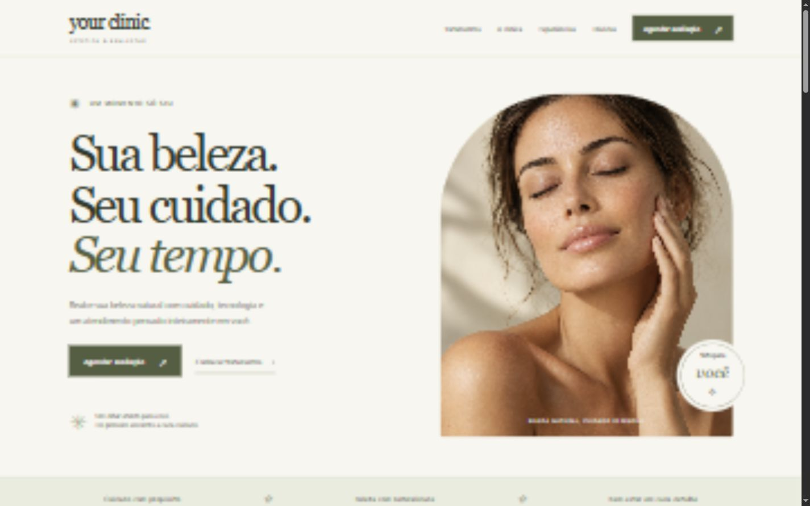

# Your Clinic

Landing page de uma clínica de estética fictícia, criada com HTML, CSS e JavaScript puro para estudo, portfólio e reutilização como modelo para clientes.

Identidade editorial com tons off-white, oliva, bege e rosé, tipografia serifada, fotografia de destaque gerada por IA e espaços generosos. Nenhum framework, backend, banco de dados, login, pagamento ou etapa de build.

## Demonstração

Abra `index.html` no navegador. O projeto ainda não foi publicado; depois de ativar o GitHub Pages, acrescente aqui a URL fornecida pelo GitHub.



Os botões de agendamento abrem um diálogo com uma mensagem demonstrativa. Nenhuma mensagem é enviada, nenhum dado é coletado e não existe atendimento real. Os seis tratamentos e três depoimentos são fictícios.

## Funcionalidades

- Menu responsivo com estado acessível, fechamento por navegação, clique externo e Escape.
- Navegação por âncoras, rolagem suave e retorno ao topo.
- Seis cards de tratamentos, seis diferenciais, seção institucional e três depoimentos.
- FAQ com cinco perguntas e uma resposta aberta por vez; funciona também sem JavaScript.
- Demonstração de WhatsApp com mensagem específica por tratamento e diálogo acessível.
- Respeito à preferência de movimento reduzido, foco visível e link para pular ao conteúdo.
- HTML semântico, descrição SEO, idioma, hierarquia de títulos, textos alternativos e favicon SVG.
- Imagem e fontes locais/do sistema, sem dependências externas em tempo de execução.

## Tecnologias

HTML5, CSS3 (Grid, Flexbox e media queries), JavaScript e SVG. A ilustração institucional é construída em CSS.

## Responsividade

Layouts adaptados para 320, 375, 425, 768, 1024 e 1440 pixels. Cards passam de três para duas e uma coluna; o menu mobile aparece abaixo de 768 pixels.

## Executar localmente

Abra `index.html` diretamente, ou, com Python instalado:

```sh
python -m http.server 4173
```

Acesse `http://localhost:4173`. Não é necessário instalar pacotes.

## Estrutura

```text
YourClinic/
├── index.html
├── css/style.css
├── js/script.js
├── assets/
│   ├── images/hero.png
│   ├── images/preview-desktop.png
│   └── icons/favicon.svg
├── README.md
└── .nojekyll
```

## Publicar no GitHub Pages

1. Crie um repositório no GitHub e envie os arquivos, mantendo `index.html` na raiz.
2. Abra **Settings → Pages** no repositório.
3. Em **Build and deployment**, escolha **Deploy from a branch**.
4. Selecione sua branch (normalmente `main`) e a pasta **/ (root)**; salve.
5. Aguarde a publicação e abra a URL informada pelo GitHub.

Os caminhos dos arquivos são relativos, compatíveis com uma URL de projeto como `https://SEU-USUARIO.github.io/your-clinic/`. Não há roteamento no servidor ou build. `.nojekyll` está incluído.

## Adaptar para uma clínica real

Em `js/script.js`, preencha `WHATSAPP_NUMBER` com código do país, DDD e número, apenas dígitos. Vazio mantém a demonstração; um número válido habilita links `wa.me` com mensagem codificada e abertura em nova aba.

Antes de usar comercialmente, substitua endereço, telefone, Instagram, horários, imagens, tratamentos e textos. Atualize também as menções à demonstração, o FAQ, a descrição SEO e os avisos de portfólio. Use depoimentos reais somente com autorização. O Instagram atual é texto demonstrativo, sem apontar para uma conta de terceiros.

## Validação

- Sintaxe de JavaScript verificada com `node --check js/script.js`.
- Página carregada em navegador Chromium; imagem carregada e nenhum erro de console observado.
- Larguras 320, 375, 425, 768, 1024 e 1440 verificadas sem rolagem horizontal.
- Menu mobile, fechamento ao navegar, FAQ exclusivo, diálogo de WhatsApp e fechamento por Escape revisados.
- Destinos das âncoras, presença de um único H1 e texto alternativo da imagem verificados.
- Revisão básica de teclado, foco e semântica; não substitui auditoria completa com leitores de tela ou testes em Safari/Firefox e aparelhos físicos.

## Imagem

`assets/images/hero.png` foi criada com a ferramenta integrada de geração de imagens. Prompt: “Use case: photorealistic-natural. Asset type: fictional premium skincare clinic website hero photograph. Editorial close-up portrait of an adult woman with natural healthy skin, eyes gently closed, serene expression, hand lightly touching cheek, bare shoulders cropped modestly, warm ivory studio backdrop, soft daylight, subtle olive and beige color grading, authentic skin texture, sophisticated beauty magazine photography. Vertical composition, face centered, no text, no logos, no watermark. Save generated image for local website use.”

## Possíveis melhorias futuras

- Versões WebP/AVIF e `srcset` para reduzir transferência em dispositivos móveis.
- Fotografias autorizadas da clínica e conteúdo real.
- Metadados de compartilhamento social e URL canônica após a publicação.
- Auditoria com leitores de tela e testes em diferentes navegadores.

## Aviso

Este é um projeto fictício desenvolvido exclusivamente para fins de estudo e portfólio. A marca Your Clinic, conteúdos, imagens e contatos utilizados são demonstrativos.
